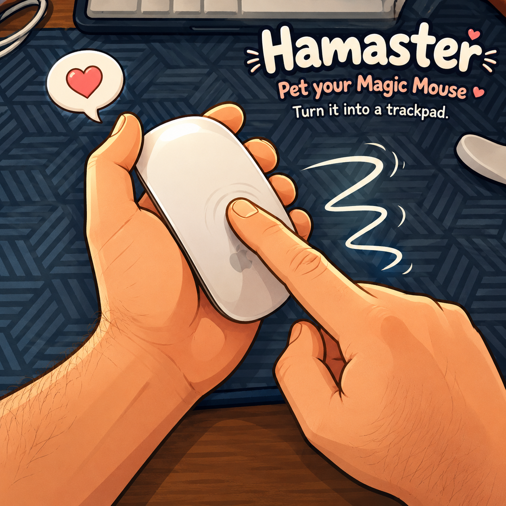
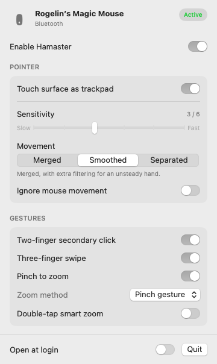

<p align="center">
  
</p>

<p align="center">
  
</p>

<h1 align="center">Hamaster</h1>

<p align="center">
  <strong>Pet your Magic Mouse. Turn it into a trackpad.</strong>
</p>

<p align="center">
  
  
  
  
</p>

Hamaster is a lightweight macOS menu-bar utility that gives the Magic Mouse a trackpad-like
pointer mode while keeping its familiar physical movement. It runs locally and offers
per-mouse controls for pointer behavior and gestures.

> [!IMPORTANT]
> **This app is made by AI.** Its design, implementation, tests, and documentation were
> produced with substantial AI assistance and reviewed through automated builds and tests.
> AI-generated software can contain mistakes—especially when it relies on undocumented
> system behavior—so review the code and test it on your own hardware before relying on it.

## Features

- Move the pointer with one finger and scroll with two
- Choose merged, smoothed, or separated pointer movement
- Optionally ignore physical mouse movement
- Secondary-click with two fingers
- Swipe with three fingers for Mission Control and App Exposé
- Pinch to zoom, with native-pinch and Command-scroll delivery modes
- Smart zoom with a one-finger double tap
- Keep separate settings for each Magic Mouse
- Pause every Hamaster feature with one master switch
- Start automatically at login

<p align="center">
  
</p>

## Requirements

- macOS 13 or later
- An Apple Magic Mouse
- Accessibility permission for synthetic pointer and gesture events
- Input Monitoring permission for device-specific movement modes

Input Monitoring is optional unless you use Separated mode or block physical mouse movement.
Hamaster explains each permission in the menu-bar panel and links directly to System Settings.

## Download

Download the universal ZIP from [Releases](https://github.com/rogelin/Hamaster/releases/latest).
It supports both Apple Silicon and Intel Macs. Unzip it, move **Hamaster.app** into
**Applications**, and grant the permissions requested in the menu.

Community builds use free ad-hoc signing and are **not notarized**. macOS may block the first
launch. After trying to open Hamaster, use **System Settings → Privacy & Security → Open Anyway**
if you trust the build. A SHA-256 checksum accompanies each ZIP.

## Privacy

Hamaster has no analytics, telemetry, advertising, accounts, or network service. It does not
collect or transmit personal data. Touch contacts and input events are processed locally in
memory, and per-mouse preferences are stored locally in macOS `UserDefaults`.

Accessibility and Input Monitoring are powerful macOS permissions. Hamaster uses them only
to observe pointing-device activity, distinguish devices, and generate the pointer or gesture
events selected in the app. The complete implementation is available in this repository for
inspection.

## Important compatibility note

Hamaster reads touch contacts through symbols from macOS's private
`MultitouchSupport.framework`. Apple does not guarantee those symbols, and a future macOS
update may change or remove them. Hardware testing is recommended after every system update.

The app is intentionally not sandboxed because it passively observes HID input and posts
system-wide events. Community release builds are ad-hoc signed. Developer ID signing and
notarization can be added by maintainers with an Apple Developer membership.

## Build and test

Open `Hamaster.xcodeproj` in Xcode, select the shared **Hamaster** scheme, and run the app.
No personal development-team identifier is committed; choose your own team if Xcode asks for
one when signing a local build.

To build and run the tests from Terminal:

```sh
xcodebuild \
  -project Hamaster.xcodeproj \
  -scheme Hamaster \
  -destination 'platform=macOS' \
  CODE_SIGNING_ALLOWED=NO \
  test
```

The test suite covers settings migration, feature gating, gesture recognition, scroll
accumulation, and device-key normalization. GitHub Actions runs the same command for pushes
and pull requests.

## Menu previews

Run `scripts/preview-menu.sh` to render 12 menu variations in light and dark appearances
into `/tmp/hamaster-menu-previews`. The fixtures do not access hardware or change saved
settings. They cover enabled and paused devices, gestures-only mode, unavailable surfaces,
missing permissions, movement-blocking and smart-zoom warnings, long device names, pinch
disabled, no devices, multiple devices with scrolling, and all features off.

## Release builds

GitHub Actions tests pushes to `main` and pull requests. Pushing a version tag such as
`v1.0.0` tests the tagged source, builds a universal Release app, and publishes a GitHub
Release containing its ZIP and SHA-256 checksum. Failed tests stop publication. The Release
workflow can also be run manually for an existing version tag, including to retry a build.
It uses the repository's automatic `GITHUB_TOKEN`; no signing secrets or paid services are required.
[Standard GitHub-hosted runners are free for public repositories](https://docs.github.com/en/billing/concepts/product-billing/github-actions).
Private repositories use the owner's included Actions allowance.

```sh
git tag v1.0.0
git push origin v1.0.0
```

To produce the same package locally:

```sh
scripts/package-release.sh 1.0.0
```

The files appear in `dist/`. The package contains both `arm64` and `x86_64`; the script checks
both architectures and verifies the ad-hoc signature before creating the archive.

## Contributing

Issues and pull requests are welcome. Please describe the macOS version and Magic Mouse model
when reporting input or gesture behavior, and include tests for logic changes when practical.

By contributing, you agree that your contribution may be distributed under the MIT License.

## License

Hamaster is available under the [MIT License](LICENSE).

